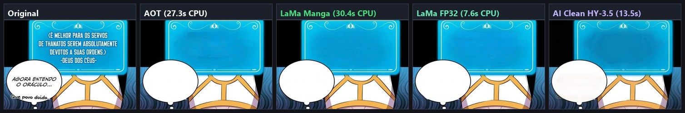
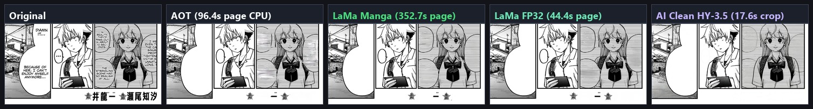
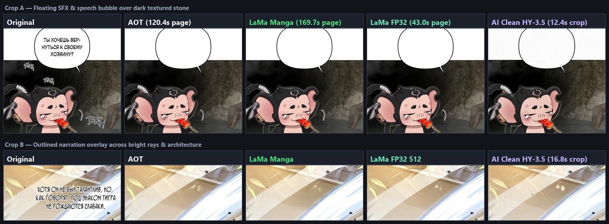
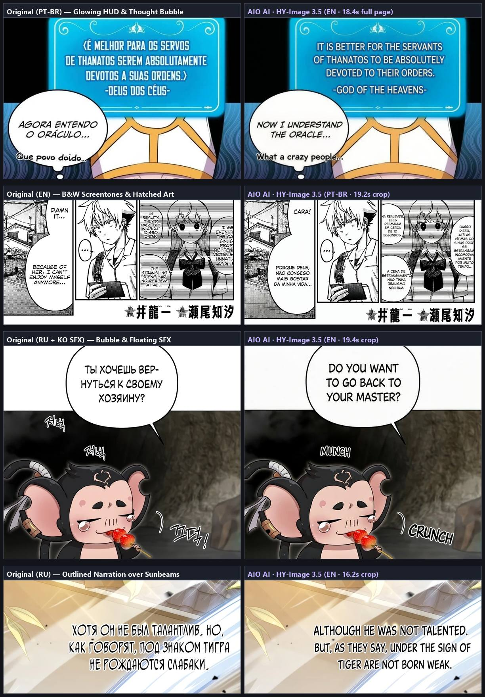
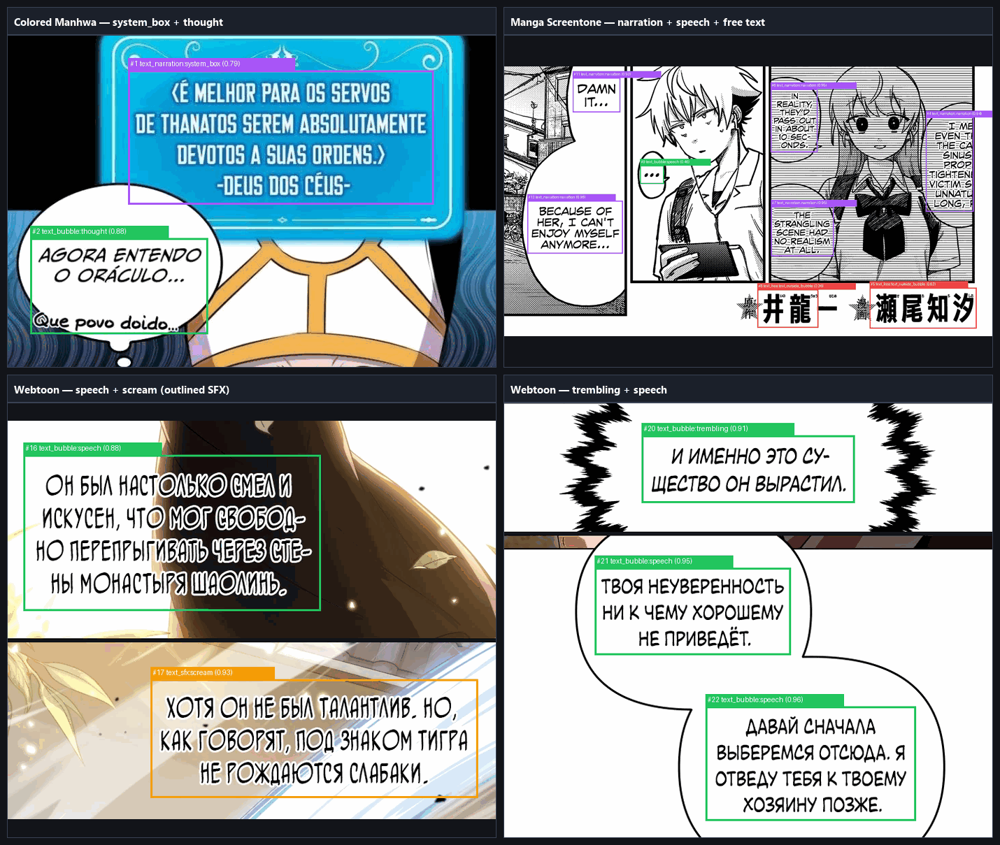

# KŌMA Studio — Model Choice & Visual Benchmarks

Choosing the right workflow and model per stage has a major impact on cleaning fidelity, typography control, turnaround speed, and scanlation flexibility. This guide documents KŌMA Studio's end-to-end benchmarks across real manga, manhwa, and webtoon samples — covering **local neural inpainting**, **Automatic AI Clean (img-to-img)**, **single-pass AIO AI (img-to-img)**, **text segmentation**, and **geometric/spectral bubble shape classification**.

---

## Quick Decision Matrix

| Profile / Content Type | Detect Text | Segment Text | Clean / Render Mode | Recommended Settings |
|---|---|---|---|---|
| **Default / GPU (Best Overall Control)** | `RT-DETR v2` | `CTD Text Mask` | `LaMa Manga Dynamic` | `crop`, margin `192`, trigger `512` |
| **CPU-Only / High Throughput** | `RT-DETR v2` or `Comic Text Detector` | `CTD Text Mask` or `Comic Text Mask` | `LaMa FP32 512` | `crop`, margin `192`, trigger `512` |
| **Clean B&W Manga (Low Disk)** | `Comic Text Detector` | `Baka Content CC` (built-in) | `AOT` (~22 MB) | `crop` or `resize` (`960`) |
| **Overlapping / Irregular Balloons** | `RT-DETR v2` + `YOLO Bubble Seg` | `CTD Text Mask` | `LaMa Manga Dynamic` | `crop`, margin `192` |
| **Skewed Scans / Book Photos** | `PP-DocLayout V3` | `Comic Text Mask` | `LaMa Manga Dynamic` | `crop`, margin `192` |
| **Heavy Stylized SFX (Editable Layer)** | `RT-DETR v2` | `CTD Text Mask` | **Automatic AI Clean** (`pad_unpad`) | OpenAI/Gemini/Custom image endpoint |
| **Fast One-Pass Redraw & Lettering** | Built-in or Guided (`Hybrid` / `Script`) | Integrated | **AIO AI (img-to-img)** (`HY-Image 3.5` / GPT Image / Gemini) | `pad_unpad`, `match_original`, `preserve_artwork` |

---

## 6-Stage Local Pipeline vs. AIO AI (img-to-img)

| Dimension | 6-Stage Pipeline (Local Inpainting + Typesetter) | 6-Stage + Automatic AI Clean | AIO AI (img-to-img · `HY-Image 3.5` / GPT / Gemini) |
|---|---|---|---|
| **Editable Text & Layered PSD Export** | **Yes** — full editable text layers, fonts, outlines, and masks | **Yes** — AI cleans the canvas, KŌMA typesets editable layers | **No** — text is baked into pixels inside the generated image |
| **Artwork Preservation Outside Text** | **Exact (`unmasked_max_diff = 0`)** outside crop masks | Subject to model decode unless masked / composited | Whole-frame redraw by default (use **Hybrid Guided + Preserve Artwork** to lock background pixels outside `bbox`) |
| **Translucent Halftones & Outlined SFX** | Good with `LaMa`; soft streaks possible with `AOT` | **Strongest raw cleanup** on rays, textures, and complex SFX | **Native typography matching** directly over SFX, gradients, and rays |
| **Glossary & Translation Memory Fidelity** | **100% deterministic** via LLM translation + glossary QA | **100% deterministic** | Use **`Script Guided`** mode to enforce exact glossary strings inside `inner_box`; **`Direct`** can hallucinate pronouns on ambiguous panels |
| **White Balloon Cleanliness** | **Pure `#FFFFFF` fill** via hybrid pre-fill + `LaMa` | Occasional faint ghost stroke residue in plain white bubbles | Re-rendered cleanly while refilling translated letters |
| **Hardware & Cost** | 100% offline / zero API cost | Requires image-edit API (or local edit model) | Requires image-edit API (or local edit model), `~16–19s` per image/panel |

---

## Clean Image Comparison (Local Inpainting vs. Automatic AI Clean)

KŌMA Studio cleans pages deterministically inside `crop` tiles using hybrid flat-bubble pre-fill heuristics (preserving exact unmasked pixels, verified at `unmasked_max_diff = 0`) followed by neural inpainting on remaining textured regions — or via **Automatic AI Clean** (`clean_image_with_ai` with `pad_unpad`) using instruction-following img-to-img models such as `HY-Image 3.5` over an OpenAI-compatible `/images/edits` endpoint.

### 1. Colored Manhwa — Glowing HUD System Boxes & Thought Bubbles (`720 × 1465`)

- **LaMa Manga Dynamic** (`30.4s` CPU) and **LaMa FP32 512** (`7.6s` CPU, **4.0× faster**) cleanly remove all outlined glyphs inside both the white thought balloon and the cyan gradient HUD card while preserving exact unmasked pixels (`unmasked_max_diff = 0`).
- **Automatic AI Clean (`HY-Image 3.5`)** (`13.5s` full page) smooths the cyan gradient well, but notice faint ghost outline residue remaining inside the plain white thought bubble where KŌMA's deterministic solid pre-fill leaves `#FFFFFF` cleanly.

### 2. Detailed B&W Manga Screentones & Hatched Art (`1688 × 2400`)

- **AOT** (`96.4s` full-page CPU) leaves visible light horizontal streaks over shaded hair and shoulder lines.
- **LaMa Manga Dynamic** (`352.7s` full-page CPU) and **LaMa FP32 512** (`44.4s` full-page CPU — **8.0× faster**) reconstruct continuous hair strands and subtle halftone shading with zero outside-mask pixel drift.
- **Automatic AI Clean (`HY-Image 3.5`)** (`17.6s` on the `1430 × 750` crop) reconstructs the horizontal striped halftone behind the semi-transparent clipped balloons cleanly and even erases the stylized bottom credit mark automatically — at the tradeoff of subtle ghosting inside the left white speech bubble and mild re-encoding softening on dense diagonal hatch strokes.

### 3. Long-Strip Colored Webtoon (`720 × 18950`, 25 Regions)

- **Crop A (Floating SFX & speech over dark stone):** **LaMa** (`43.0s` `LaMa FP32` / `169.7s` `LaMa Manga` full-strip CPU) and **AI Clean (`HY-Image 3.5`, `12.4s` crop)** both erase floating outlined SFX and Russian dialogue cleanly without halo artifacts around the character.
- **Crop B (Outlined narration over diagonal sunbeams):** **LaMa Manga** and **LaMa FP32** keep continuous sunbeams with `unmasked_max_diff = 0`; **AI Clean (`HY-Image 3.5`, `16.8s` crop)** delivers ultra-clean multi-beam gradient reconstruction (adding only two tiny synthetic flare bokeh spots in the highlight).

---

## AIO AI (Image-to-Image) End-to-End Benchmarks

In **AIO AI** mode (`run_aio_ai_image_edit`), a single multimodal image-editing pass reads the source text, cleans the original lettering, matches comic font styling (`match_original`), aligns inside bubble boundaries (`refine_alignment`), and translates sound effects (`sfx_mode="translate"`). Kōma handles long strips automatically (`plan_segments_with_config`), protects aspect ratios via **`pad_unpad`**, and supports **`preserve_artwork`** compositing outside detected bounding boxes.

### Measured AIO AI (`HY-Image 3.5`, `direct` mode, `pad_unpad`) Results

| Sample Scene | Language Pair | Input Size | Time | Visual Quality & Honest Tradeoffs |
|---|---|---|---|---|
| **Colored Manhwa HUD + Thought (`pt1.jpg`)** | `pt-br → en` | `720 × 1465` (full page) | `18.43s` | **Strongest end-to-end result.** Filigree HUD borders, cyan glow gradient, elliptical thought centering, and floating outlined aside (`What a crazy people...`) render sharply with zero spelling errors. Minor warm tone shift outside text unless `preserve_artwork` is enabled. |
| **B&W Manga Screentones (`en1.webp` panel crop)** | `en → pt-br` | `1430 × 750` | `19.25s` | Preserves panel borders and horizontal screentones behind dialogue well, while exposing typical **`direct` mode limits**: `"her" → "dele"` pronoun flip without chapter context, untranslated stylized bottom Japanese credits, and slight clipping noise in the tight half-cropped right margin balloon. |
| **Webtoon Floating SFX + Bubble (`ru1.png` Crop A)** | `ru (+ ko SFX) → en` | `640 × 575` | `19.36s` | Cleanly translates bubble dialogue and redraws both handwritten floating SFX into matching outlined comic lettering (`MUNCH` / `CRUNCH`) while keeping the dark cave wall and character sharp. Semantic SFX guesses from visual context can diverge from literal SFX script without `Script Guided` mode. |
| **Webtoon Sunbeam Narration (`ru1.png` Crop B)** | `ru → en` | `670 × 320` | `16.19s` | Replicates tall narrow white-outlined comic typography seamlessly across diagonal light rays and roof architecture (literal phrasing shows why dedicated LLM translation + `Script Guided` is preferred for literary prose). |
| **Platform Copyright Card (`kr1.png`, full page)** | `zh-tw → en` | `800 × 800` | `16.24s` | Clean English layout under intact green `WEBTOON` logo (normalizes green header lines into uniform white body color). |

### AIO AI Execution Modes in KŌMA Studio

1. **`Direct`:** Fast one-shot autonomy with zero prior stages required (`style_mode="match_original"`, `sfx_mode="translate"`). Great for stylized SFX, colored system boxes, and previewing chapters quickly.
2. **`Hybrid Guided`:** Feeds KŌMA's `RT-DETR v2` / `YOLO` region boxes (`shape_kind`, `inner_box`) and enables **`preserve_artwork`** compositing so characters, eyes, and screentones outside text boxes remain pixel-locked.
3. **`Script Guided`:** Feeds verified translations from **Stage 3 Translate** (glossary + Translation Memory intact) as exact `EXACT TRANSLATION` strings per `inner_box`, preventing pronoun flips or literal phrasing while retaining `HY-Image 3.5` / GPT Image / Gemini typography and seamless background reconstruction.

---

## Measured End-to-End Cleaning Latency (Local CPU vs. AI Clean)

Local models measured on ONNX Runtime CPU with `CTD Text Mask` segmentation, hybrid solid-bubble pre-fill, feathered crop blending, and `crop_margin = 192`; generative AI Clean (`clean_image_with_ai`) measured over OpenAI-compatible `/images/edits` with `HY-Image 3.5` (`pad_unpad`).

| Sample | Resolution | Regions | CTD / CC Mask | `AOT` (~22 MB, CPU) | `LaMa Manga` (~196.7 MB, CPU) | `LaMa FP32` (~198.4 MB, CPU) | `AI Clean` (`HY-Image 3.5`) | Unmasked Pixel Diff (Local) |
|---|---|---|---|---|---|---|---|---|
| **Manga Screentones (`en1.webp`)** | `1688 × 2400` (`1430×750` AI crop) | 13 | 8.71% / 8.19% | `96.39s` | `352.70s` | **`44.39s`** | `17.62s` *(panel crop)* | `0` (exact) |
| **Notice Graphic (`kr1.png`)** | `800 × 800` | 2 | 13.80% / 12.30% | `7.55s` | `12.92s` | **`3.69s`** | `9.19s` *(full page)* | `0` (exact) |
| **Colored HUD + Thought (`pt1.jpg`)** | `720 × 1465` | 2 | 6.65% / 5.87% | `27.29s` | `30.39s` | **`7.55s`** | `13.54s` *(full page)* | `0` (exact) |
| **Long Webtoon (`ru1.png`)** | `720 × 18950` | 25 | 2.84% / 2.54% | `120.37s` | `169.72s` | **`42.96s`** | `12.45s` / `16.81s` *(crops)* | `0` (exact) |

### Clean Image Model Breakdown

| Model | Size | Strengths | Tradeoffs / Notes |
|---|---|---|---|
| **`lama_manga`** (**Recommended**) | ~196.7 MB | Best deterministic local reconstruction on gradients, colored panels, HUD boxes, and screentones; dynamic crop dimensions. | Heavy on CPU for multi-panel pages; use GPU when available or switch to `lama_fp32` on CPU. |
| **`lama_fp32`** (**Fast CPU**) | ~198.4 MB | Full FP32 color accuracy with **2–8× faster CPU throughput** than `lama_manga`; ideal CPU default for colored comics. | Fixed 512×512 inference tile (pairs automatically with `crop` HD strategy and `192px` crop margin). |
| **`aot`** (**Lightweight**) | ~22.0 MB | Tiny download; good for flat monochrome dialog bubbles or constrained disk setups. | Can blur screentones, hair, and colored backgrounds; slower per CPU tile than `lama_fp32`. |
| **`opencv_lama`** (Legacy) | ~88.3 MB | Kept for legacy OpenCV Zoo compatibility. | Quantized QDQ graph overhead on CPU ONNX Runtime; prefer `lama_fp32` or `lama_manga`. |
| **Automatic AI Clean (`HY-Image 3.5` / GPT / Gemini)** | Cloud / Custom | Superior reconstruction of huge stylized SFX, translucent sunbeams, and complex multi-object backgrounds. | Non-deterministic outside masks without compositing; can leave faint ghosting on empty white bubbles; requires API endpoint. |

**Default Clean Settings:** `hd_strategy = crop`, `crop_margin = 192`, `crop_trigger_size = 512`, `mask_dilation = 5`. These defaults preserve native sharpness around each cluster while minimizing redundant full-page compute.

---

## Segment Text Model Comparison

| Model | Size | Method | When to Use |
|---|---|---|---|
| **`ctd_text_seg`** (**Recommended**) | ~90.3 MB (shared) | Neural U-Net pixel mask from Comic Text Detector | **Default choice.** Reuses `comic_text_detector` weights with zero duplicate storage; sharply isolates outlined text over colored art and HUD borders. |
| **`comic_text_mask`** | ~54.7 MB (MIT) | Standalone ResNet18 + U-Net crop segmenter | Smaller standalone download; strong per-crop precision across stylized lettering and multilingual text. |
| **`baka_content_cc`** | 0 MB (built-in) | Otsu thresholding + connected components | Instant zero-download fallback; works best on high-contrast black text inside plain white bubbles. |

---

## Detect Text & Automatic Bubble Shape Classification

Rather than relying on brittle image-template matching alone, KŌMA combines neural detection boxes (plus optional **YOLO Bubble Seg** pixel contours) with **geometric and spectral bubble analysis** (`models/detection/bubble/shape_classifier.py`):

- **Detected & Classified Classes:** `speech`, `thought` (scalloped edges & trailing dots), `scream` (spiky/jagged perimeter), `whisper` (dashed outlines), `narration` (rectilinear narration frames), `system_box` (colored high-saturation HUD/status panels), `trembling` (wavy perimeter), and `text_outside_bubble`.
- **Inner Typography Bounds:** Distance-transform and contour refinement compute safe `inner_box` padding inside rounded, square, spiky, or cloud polygons so typeset translations sit cleanly without clipping edges.

### Detector Engine Comparison

| Model | Size | Capabilities | Best For |
|---|---|---|---|
| **`font_rtdetr_v2`** (**Recommended**) | ~160.7 MB | Single-pass bubble + inside-text + free-text detection fed into KŌMA's shape pipeline | General manga, manhwa, webtoons, and Western comics. |
| **`comic_text_detector`** | ~90.3 MB | Fast comic text box detector; shares weights file with `ctd_text_seg` | Fast CPU workflows or when pairing detection + neural segmentation from one weight file. |
| **`yolo_bubble`** | ~11.3 MB | YOLOv8-seg polygon instance segmentation of speech bubbles (`Manga109`) | Overlapping balloons, tilted panels, or extracting exact pixel bubble contours. |
| **`pp_doclayout_v3`** | ~127.1 MB | Document layout + structural reading order | Camera scans, skewed pages, light novels, and multi-column magazine spreads. |
